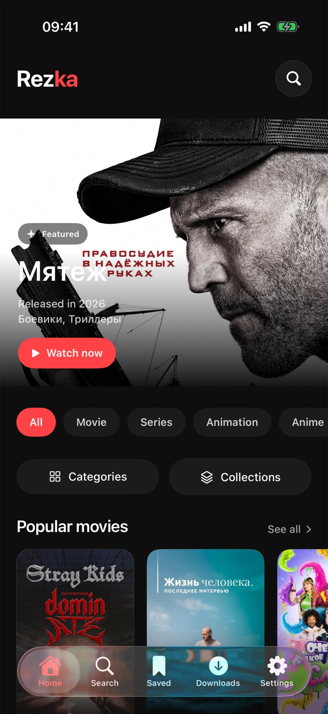
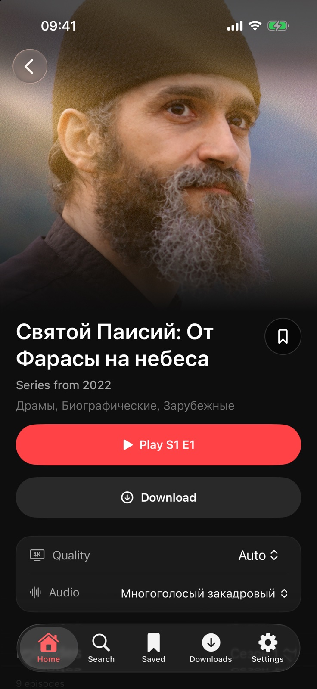
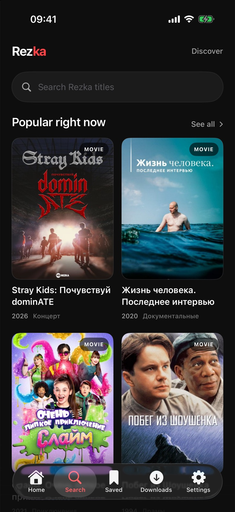

# Rezka: HDRezka app for iPhone (iOS)

**An unofficial HDRezka client that lets you watch the films and series from the HDRezka website in a Netflix-style experience, like a premium streaming platform.** It tracks the films and episodes you have watched, so you can continue exactly where you left off. It is a native iPhone app with AirPlay to your TV, Picture in Picture and offline downloads.

<p align="center">
  
  
  
</p>

Looking for Android, tablets or Google TV? See [rezka-android](https://github.com/lastrowcritic/rezka-android). Want your history on every device? Host your own [rezka-sync-server](https://github.com/lastrowcritic/rezka-sync-server).

## Disclaimer

This project is only a client. It does not host, upload, store or distribute any films, series or other media. Everything you see in the app is loaded directly from the third party HDRezka website. We are not affiliated with that website and are not responsible for its content, its availability or how it is used. You are responsible for following the laws of your country when using it.

## What it does

- **Browse** the live catalogue: new releases, popular titles, genres, categories and collections.
- **Search** in Latin or Cyrillic.
- **Title pages** with poster, rating, description, cast, comments, franchises and related titles.
- **Choose** the voice-over (translation), season, episode and video quality before you press play.
- **Watch** in the standard iPhone player, with AirPlay, Picture in Picture, playback speed and full screen.
- **Continue watching** from exactly where you stopped. Each episode remembers its own position.
- **Autoplay** the next episode after a short countdown, even across seasons. You can turn it off.
- **Download** films and episodes to watch offline.
- **Hide countries** you are not interested in, across the whole app.
- **Watchlist** and viewing history, saved on your iPhone.
- **Sync** your history across devices with your own server (optional).

All of your data stays on your iPhone. The app has no analytics and no server of its own.

## Sync across devices (optional)

Your history and the position in each episode can follow you between your phone, tablet, TV and iPhone. Sync uses a small server that you host yourself: [rezka-sync-server](https://github.com/lastrowcritic/rezka-sync-server). It is a few PHP files that run on almost any web hosting plan, and its README explains the setup step by step.

Then open **Settings → Sync across devices** in the app, enter your server address and sign in. Sync is off until you do this.

## How it works

The app works like a web browser that understands the HDRezka pages:

1. **Finding a working website address.** HDRezka is available on many mirror domains, and some are blocked in some countries. When the app starts, it downloads the list in [`mirrors.json`](mirrors.json) from this repository and picks the first mirror that responds. You can also choose a mirror yourself in Settings.
2. **Reading pages.** The app downloads the website's HTML pages and reads the titles, posters and details from them with [SwiftSoup](https://github.com/scinfu/SwiftSoup).
3. **Getting the video.** When you press play, the app asks the website for the video links, in the same way the website's own player does. The website hides those links in an encoded form. The app decodes them and passes the video to the iPhone player.
4. **Website checks.** Sometimes the website shows a "checking your browser" page. The app then opens that page in a small browser window so you can complete it. After that it continues normally.

Your progress is saved every few seconds while you watch, and when you pause or close the player.

## Install

Download the latest `.ipa` file from [Releases](https://github.com/lastrowcritic/rezka-ios/releases/latest).

The `.ipa` is not signed, because the app is not on the App Store. Install it with a sideloading tool such as [AltStore](https://altstore.io) or [Sideloadly](https://sideloadly.io). These tools sign the app with your own Apple ID. With a free Apple ID, the app must be refreshed every 7 days.

## Build it yourself

You need a Mac with Xcode 16 or newer. iOS 17 or newer is required on the iPhone.

1. Open `RezkaPort.xcodeproj` in Xcode.
2. Select the `RezkaPort` target, open **Signing & Capabilities** and choose your own team. If Xcode reports that the bundle identifier is taken, change it to something unique.
3. Connect your iPhone and press **Run**.

The Xcode project is generated from `project.yml`. If you change the project settings, run `xcodegen generate` (from [XcodeGen](https://github.com/yonaskolb/XcodeGen)) to update it.

To build an unsigned `.ipa` from the command line:

```sh
xcodebuild -scheme RezkaPort -configuration Release -destination 'generic/platform=iOS' \
  -derivedDataPath build CODE_SIGNING_ALLOWED=NO build
mkdir -p Payload && cp -R build/Build/Products/Release-iphoneos/RezkaPort.app Payload/
zip -qr Rezka.ipa Payload
```

## Tests

```sh
swift test
```

These tests check the page parsing, the video link decoding and the mirror handling against saved sample pages, so no internet connection is needed. The Xcode project also includes interface tests that run in the iPhone simulator.

## Project layout

| Folder | What is inside |
| --- | --- |
| `StreamingApp/App` | App start-up |
| `StreamingApp/Features` | Screens: home, search, title page, player, downloads, settings |
| `StreamingApp/Data/Rezka` | Website access: mirrors, page parsing, video link decoding |
| `StreamingApp/Domain` | Shared data types such as titles, episodes and history |
| `StreamingApp/Core` | App state, saved history and downloads |
| `StreamingAppTests` | Automated tests and sample pages |

## Updating the mirror list

Edit [`mirrors.json`](mirrors.json) and push to the `main` branch. Installed apps download the new list the next time they start.

## Keywords

HDRezka app, HDRezka client, HDRezka iOS, HDRezka iPhone, Rezka IPA, watch films and series on iPhone, unofficial HDRezka player. Приложение HDRezka для iPhone и iOS, клиент HDRezka (Rezka, Резка), смотреть фильмы и сериалы, продолжить просмотр с того же места.

## Known limits

The website can change its layout or its video encoding at any time, which can break parts of the app until it is updated. Separate subtitle files from the website are not shown. Only subtitles built into the video are available in the player.
